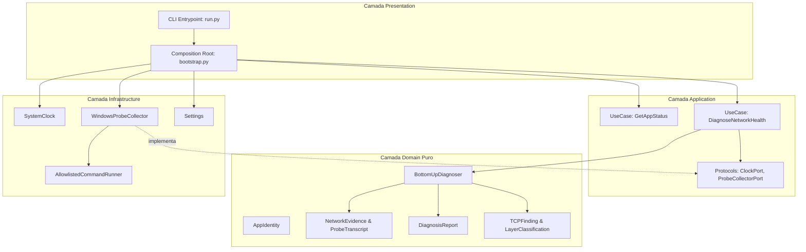

# Arquitetura Técnica: Script Net Health

Documento de especificação técnica da arquitetura baseada em **Domain-Driven Design (DDD)** e **Clean Architecture / Hexagonal (Ports & Adapters)**.

## Visão Geral

O **Script Net Health** é um utilitário NetOps projetado para coletar probes no host Windows físico e diagnosticar deterministamente a pilha de rede BOTTOM-UP de acordo com as 4 camadas do modelo TCP/IP (RFC 1122).
A esteira de qualidade, testes e linters opera no WSL Linux. Não há utilização de SSH para equipamentos de rede nesta fatia arquitetural.

## Diagrama de Camadas

## Responsabilidades por Camada

### 1. Camada Domain (`app/src/domain/`)
- Totalmente desacoplada de tecnologia de persistência, IO ou frameworks.
- **Entidades e Valores:** `AppIdentity`, `NetworkEvidence`, `ProbeTranscript`, `DiagnosisReport`.
- **Serviço de Diagnóstico:** `BottomUpDiagnoser` analisa link local (gateway, ARP), conectividade IP (ping WAN), transporte (conexão TCP direta na porta alvo) e aplicação (DNS / HTTP).
- **Sem Efeitos Colaterais:** Não emite logs e não executa chamadas externas.

### 2. Camada Application (`app/src/application/`)
- Orquestra os fluxos do sistema sem conhecer os detalhes da infraestrutura.
- **Casos de Uso:**
  - `DiagnoseNetworkHealth`: Invoca o coletor de probes, alimenta o serviço de domínio e obtém o relatório de diagnóstico estruturado.
  - `GetAppStatus`: Fornece metadados operacionais e identidade da aplicação sob a flag `--status`.
- **Portas:** `ClockPort` e `ProbeCollectorPort` definidos como `typing.Protocol`.

### 3. Camada Infrastructure (`app/src/infrastructure/`)
- Contém os adaptadores que interagem com o sistema operacional e serviços externos.
- `AllowlistedCommandRunner`: Executa exclusivamente comandos permitidos (`ipconfig`, `ping`, `arp`, `route`, `netstat`, `nslookup`, `tracert`) com `shell=False` e timeouts controlados.
- `WindowsProbeCollector`: Coleta e estrutura as transcrições das probes.
- `throughput_probe`: Realiza medição de transferência de dados se ativado.
- `Settings`: Leitura e validação de configurações a partir de variáveis de ambiente.

### 4. Camada Presentation (`app/src/presentation/`)
- Interface do usuário e ponto de composição.
- `presentation/cli/bootstrap.py`: Instancia as configurações, adaptadores concretos e injeta-os nos casos de uso.
- `presentation/logging/setup.py`: Configuração do pipeline de logging estruturado da aplicação.
